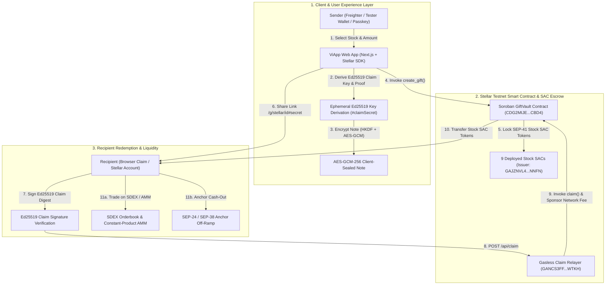

<p align="center"></p>

# ViApp: Tokenized Stocks & Gift Vault on Stellar (Testnet MVP)

[](https://github.com/viappToken/viapp/actions/workflows/ci.yml)
[](https://stellar.expert/explorer/testnet/contract/CDG2MIJEGLAIS37FXNF3KSFIQYL4VN5AUVLRLXK47SHQTHVVILPKCBD4)
[](packages/contracts/stellar)
[](LICENSE)

Send someone their first share of Apple, NVIDIA, or Tesla as a shareable link. The recipient opens the link, signs in with Google, email, or a Stellar wallet, and claims tokenized stock on the **Stellar Testnet** with zero gas fees via ViApp's sponsored relayer.

> **Status: Stellar Testnet MVP.** The core `viapp-gift-vault` smart contract (`CDG2MIJEGLAIS37FXNF3KSFIQYL4VN5AUVLRLXK47SHQTHVVILPKCBD4`) and all 9 tokenized stock Stellar Asset Contracts (SACs) are deployed and live on **Stellar Testnet** (`.deployments/testnet.json`). Mainnet deployment and regulated SEP-0008 issuer integration are scheduled in Milestone 1–3 of [`docs/ROADMAP.md`](docs/ROADMAP.md).

[Live Testnet Contract](https://stellar.expert/explorer/testnet/contract/CDG2MIJEGLAIS37FXNF3KSFIQYL4VN5AUVLRLXK47SHQTHVVILPKCBD4) · [Testnet Verification Results](docs/TESTNET_RESULTS.md) · [Deployment Manifest](.deployments/testnet.json) · [Architecture Specification](docs/ARCHITECTURE.md) · [Technical Roadmap](docs/ROADMAP.md) · [CI Pipeline](.github/workflows/ci.yml)

---

## End-to-End System Architecture

ViApp coordinates Stellar Smart Contract (`viapp-gift-vault`) escrow custody, client-side ephemeral Ed25519 claim secrets isolated in the URL `#` fragment, AES-256-GCM encrypted notes, SEP-0041 Stellar Asset Contracts (SACs), and gasless relayer claim settlement.



---

## User Interface & Live Application Flow

<p align="center">
  
</p>

<br>

<p align="center">
  
  &nbsp;
  
</p>

---

## Live Stellar Testnet Execution & Verification Results

The `viapp-gift-vault` smart contract (compiled to `wasm32v1-none`, 13,062 bytes, atomic `__constructor`) and all 9 tokenized stock Stellar Asset Contracts (SACs) are deployed and verified on **Stellar Testnet**. Full CLI command receipts and ledger proofs are in [`docs/TESTNET_RESULTS.md`](docs/TESTNET_RESULTS.md) and [`.deployments/testnet.json`](.deployments/testnet.json).

### Verified On-Chain Contract & Transaction Matrix (Stellar Testnet)

| Resource / Action | On-Chain Function | Value / Transaction Hash | Status | Explorer Link |
|---|---|---|:---:|---|
| **GiftVault Contract ID** | `__constructor` | `CDG2MIJEGLAIS37FXNF3KSFIQYL4VN5AUVLRLXK47SHQTHVVILPKCBD4` | **ACTIVE** | [Stellar Expert](https://stellar.expert/explorer/testnet/contract/CDG2MIJEGLAIS37FXNF3KSFIQYL4VN5AUVLRLXK47SHQTHVVILPKCBD4) |
| **WASM Hash (`wasm32v1-none`)** | `stellar contract upload` | `14e4c5a834f2bd49719a030108c7b9140c6cdeca89859a0f84e58ecc004127b5` | **VERIFIED** | [View Upload Tx](https://stellar.expert/explorer/testnet/tx/9311be00c2f195ea2b669be8b4da07337da9e0c27a97173165bcb3a50467ff6d) |
| **Mint & Trustlines (9 Stocks)** | `changeTrust` + `payment` | `fd96a64efd56f2005299ec92b90cfbfb7af8f21fd91fc5e091d1286374d4f39a` | **SUCCESS** | [View Mint Tx](https://stellar.expert/explorer/testnet/tx/fd96a64efd56f2005299ec92b90cfbfb7af8f21fd91fc5e091d1286374d4f39a) |
| **Deploy & Init GiftVault** | `__constructor(admin, relayer, tokens)` | `91a51bd598a3f77e3ca50cd0ba5cd96c8b23d53e6174cb444137ab88761e85d2` | **SUCCESS** | [View Deploy Tx](https://stellar.expert/explorer/testnet/tx/91a51bd598a3f77e3ca50cd0ba5cd96c8b23d53e6174cb444137ab88761e85d2) |
| **Dynamic Token Whitelist** | `set_token_listed(QQQ, true)` | `a93c5a042e1762acd6f1571b001b988071fd87dca76aaa3651eb3869984a859e` | **SUCCESS** | [View Listing Tx](https://stellar.expert/explorer/testnet/tx/a93c5a042e1762acd6f1571b001b988071fd87dca76aaa3651eb3869984a859e) |
| **Create Gift #1 (`1.0 NVDA`)** | `create_gift(...)` | `a45ef1cc24c138ccfd2b9e55645247482a4621004816535ec819e45ef902f5cc` | **SUCCESS** | [View Create Gift #1](https://stellar.expert/explorer/testnet/tx/a45ef1cc24c138ccfd2b9e55645247482a4621004816535ec819e45ef902f5cc) |
| **Gasless Claim Gift #1 (`NVDA`)** | `claim(1, recipient, sig)` | `abdefd9b50f8575178869779022ab3e1171046eefcc460595e1b92dc2c93b109` | **SUCCESS** | [View Claim Gift #1](https://stellar.expert/explorer/testnet/tx/abdefd9b50f8575178869779022ab3e1171046eefcc460595e1b92dc2c93b109) |
| **Create Open Gift #2 (`0.5 AAPL`)**| `create_gift(...)` | `5b8b7809ae715c90e2259c21b46d2c90982ab7a1ddd0437e7a97df4119dfe251` | **OPEN** | [View Create Gift #2](https://stellar.expert/explorer/testnet/tx/5b8b7809ae715c90e2259c21b46d2c90982ab7a1ddd0437e7a97df4119dfe251) |
| **Create Open Gift #3 (`0.7 NVDA`)**| `create_gift(...)` | `1b6661dcccc7dd4e76de910354c384f18ae19f89f21a5b8f5ebdfa85d0af9bfc` | **OPEN** | [View Create Gift #3](https://stellar.expert/explorer/testnet/tx/1b6661dcccc7dd4e76de910354c384f18ae19f89f21a5b8f5ebdfa85d0af9bfc) |

---

## Deployed Stellar Asset Contracts (SACs) & Protocol Accounts on Testnet

### Core Protocol Accounts & Settlement SACs

| Role | Address / Contract ID | Network | Explorer Link |
|---|---|:---:|---|
| **Soroban GiftVault Contract** | `CDG2MIJEGLAIS37FXNF3KSFIQYL4VN5AUVLRLXK47SHQTHVVILPKCBD4` | Testnet | [Stellar Expert](https://stellar.expert/explorer/testnet/contract/CDG2MIJEGLAIS37FXNF3KSFIQYL4VN5AUVLRLXK47SHQTHVVILPKCBD4) |
| **ViApp Stock Asset Issuer** | `GAJZNVL4IOXRII77S22CHDW7E2UWICAMWLFMX22B3YW2PVBQ7RLNNNFN` | Testnet | [Stellar Expert](https://stellar.expert/explorer/testnet/account/GAJZNVL4IOXRII77S22CHDW7E2UWICAMWLFMX22B3YW2PVBQ7RLNNNFN) |
| **ViApp Gasless Claim Relayer** | `GANCS3FFF5TPPCBCNO4MFTMEIMDK4BO2LJYTEBG57F3DNX7JRYJ5WTKH` | Testnet | [Stellar Expert](https://stellar.expert/explorer/testnet/account/GANCS3FFF5TPPCBCNO4MFTMEIMDK4BO2LJYTEBG57F3DNX7JRYJ5WTKH) |
| **ViApp Vault Admin / Sender** | `GAZWESWQPZOIH2EH3IL37THBLKGLAC5FCHTLMWAXJGLKJPT4NRRIHN6B` | Testnet | [Stellar Expert](https://stellar.expert/explorer/testnet/account/GAZWESWQPZOIH2EH3IL37THBLKGLAC5FCHTLMWAXJGLKJPT4NRRIHN6B) |
| **Native XLM SAC** | `CDLZFC3SYJYDZT7K67VZ75HPJVIEUVNIXF47ZG2FB2RMQQVU2HHGCYSC` | Testnet | [Stellar Expert](https://stellar.expert/explorer/testnet/contract/CDLZFC3SYJYDZT7K67VZ75HPJVIEUVNIXF47ZG2FB2RMQQVU2HHGCYSC) |
| **Circle Testnet USDC SAC** | `CBIELTK6YBZJU5UP2WWQEUCYKLPU6AUNZ2BQ4WWFEIE3USCIHMXQDAMA` | Testnet | [Stellar Expert](https://stellar.expert/explorer/testnet/contract/CBIELTK6YBZJU5UP2WWQEUCYKLPU6AUNZ2BQ4WWFEIE3USCIHMXQDAMA) |

### 9 Deployed Tokenized Stock SACs Listed in `GiftVault` (Stellar Testnet)

All 9 stock assets are issued by `GAJZNVL4IOXRII77S22CHDW7E2UWICAMWLFMX22B3YW2PVBQ7RLNNNFN`, deployed as SEP-0041 Stellar Asset Contracts on Testnet, and whitelisted on-chain in `GiftVault`:

| Symbol | Company / Asset Name | Deployed Stellar SAC Contract ID (Testnet) | Classic Asset Identifier | Decimals | Explorer Link |
|:---:|---|---|---|:---:|:---:|
| **AAPL** | Apple Inc. | `CBUEWQFAQJUMIU7PU6U64Q35NCGF752BB7JHYKMEUZ6OA7767S66EYJB` | `AAPL:GAJZNVL4...` | 7 | [Stellar Expert](https://stellar.expert/explorer/testnet/contract/CBUEWQFAQJUMIU7PU6U64Q35NCGF752BB7JHYKMEUZ6OA7767S66EYJB) |
| **NVDA** | NVIDIA Corp | `CAX6GMJ7R4SKDEPHDFPJJMGYXNBWNFUOLDZZIQUV3PMRIMDRGUEY3RZV` | `NVDA:GAJZNVL4...` | 7 | [Stellar Expert](https://stellar.expert/explorer/testnet/contract/CAX6GMJ7R4SKDEPHDFPJJMGYXNBWNFUOLDZZIQUV3PMRIMDRGUEY3RZV) |
| **TSLA** | Tesla, Inc. | `CCX7WIJYXP2HXPMKKAOLYSMTVTLFYZDRBC5OR3O4S2QGBGUWN5NZQUVU` | `TSLA:GAJZNVL4...` | 7 | [Stellar Expert](https://stellar.expert/explorer/testnet/contract/CCX7WIJYXP2HXPMKKAOLYSMTVTLFYZDRBC5OR3O4S2QGBGUWN5NZQUVU) |
| **MSFT** | Microsoft Corp | `CA566SBZVF5XPOHA5IBIDNSKJ7OBD5UT7V5LZZUSSQCXJ3BQ7RXNMVAU` | `MSFT:GAJZNVL4...` | 7 | [Stellar Expert](https://stellar.expert/explorer/testnet/contract/CA566SBZVF5XPOHA5IBIDNSKJ7OBD5UT7V5LZZUSSQCXJ3BQ7RXNMVAU) |
| **AMZN** | Amazon.com Inc. | `CCSCABC5NOE7VSZY7FJOOQOGVIHIHCXW2G5ETERS3J2CPAMF3DKFLAOL` | `AMZN:GAJZNVL4...` | 7 | [Stellar Expert](https://stellar.expert/explorer/testnet/contract/CCSCABC5NOE7VSZY7FJOOQOGVIHIHCXW2G5ETERS3J2CPAMF3DKFLAOL) |
| **GOOGL**| Alphabet Inc. | `CDLGAWB22W2PSU6UBTIC2O2XOX7AXQQXEM6V4TGIZWW6OH6VA6NAHXJD` | `GOOGL:GAJZNVL4...` | 7 | [Stellar Expert](https://stellar.expert/explorer/testnet/contract/CDLGAWB22W2PSU6UBTIC2O2XOX7AXQQXEM6V4TGIZWW6OH6VA6NAHXJD) |
| **META** | Meta Platforms Inc. | `CABP7JTR5F7VAX73NIWFAMJVN3HDAOG6TALS62UEUQHY3ZSJ3T23VKWC` | `META:GAJZNVL4...` | 7 | [Stellar Expert](https://stellar.expert/explorer/testnet/contract/CABP7JTR5F7VAX73NIWFAMJVN3HDAOG6TALS62UEUQHY3ZSJ3T23VKWC) |
| **SPY**  | SPDR S&P 500 ETF | `CCD3SEF2BGN4FSSQLXACT2V2I7QWVA2HW54HJCWJMKHKJ7ZYSXXCSH5Z` | `SPY:GAJZNVL4...` | 7 | [Stellar Expert](https://stellar.expert/explorer/testnet/contract/CCD3SEF2BGN4FSSQLXACT2V2I7QWVA2HW54HJCWJMKHKJ7ZYSXXCSH5Z) |
| **QQQ**  | Invesco QQQ Trust | `CCON7JI5MMA2A55E4K6VCAVQV4GXP37BLPBRIKENFPSSP33ADTF7C7Q7` | `QQQ:GAJZNVL4...` | 7 | [Stellar Expert](https://stellar.expert/explorer/testnet/contract/CCON7JI5MMA2A55E4K6VCAVQV4GXP37BLPBRIKENFPSSP33ADTF7C7Q7) |

---

## Developer Quick Start

```bash
# Clone the repository
git clone https://github.com/viappToken/viapp.git
cd viapp

# Install dependencies across all workspaces
npm install

# Run Soroban smart contract unit & auth-tree tests (9 passing Rust tests)
cd packages/contracts/stellar && cargo test && cd ../../..

# Run TypeScript Stellar protocol & core test suites
npm test

# Verify live GiftVault state on Stellar Testnet via Stellar CLI
stellar contract invoke \
  --id CDG2MIJEGLAIS37FXNF3KSFIQYL4VN5AUVLRLXK47SHQTHVVILPKCBD4 \
  --source-account GAZWESWQPZOIH2EH3IL37THBLKGLAC5FCHTLMWAXJGLKJPT4NRRIHN6B \
  --network testnet \
  --send=no \
  -- listed_tokens
```

---

## Community, Contributing & Open-Source Attribution

* **[Contributor Guidelines (CONTRIBUTING.md)](CONTRIBUTING.md)**: Setup instructions, coding conventions, and our Drips Wave contributor workflow (`bounty:100`, `bounty:150`, `bounty:200`).
* **[Contributors & Attribution (CONTRIBUTORS.md)](CONTRIBUTORS.md)**: Maintainer ledger and open-source attribution (dark-luxury envelope UI adapted from [`ramakrishnanhulk20/Moi`](https://github.com/ramakrishnanhulk20/Moi) under MIT License and re-architected for Stellar Soroban smart contracts).
* **[Security Policy (SECURITY.md)](SECURITY.md)**: Responsible vulnerability disclosure policy.

## License

Apache 2.0 License (with MIT UI components attributed in [`CONTRIBUTORS.md`](CONTRIBUTORS.md)).
