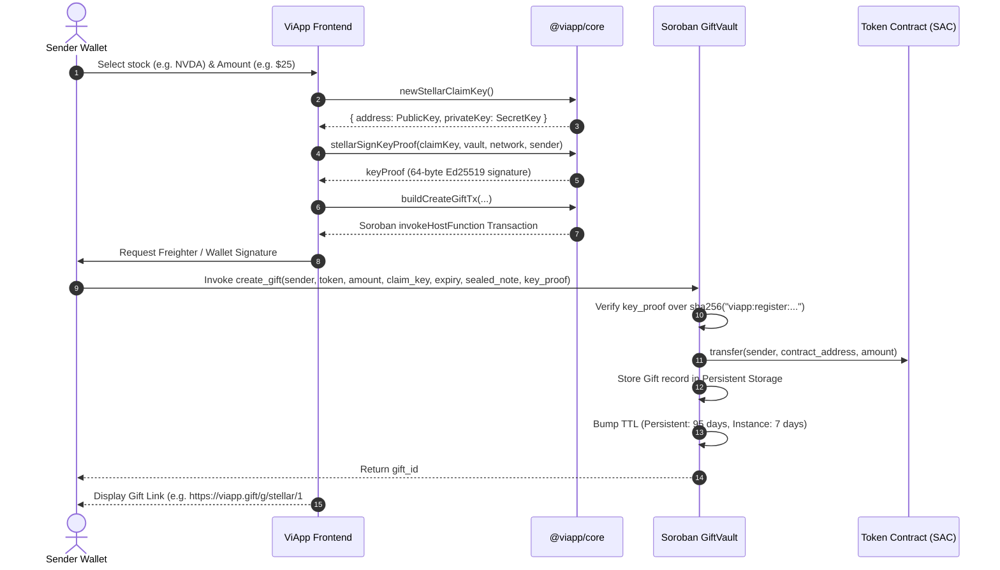
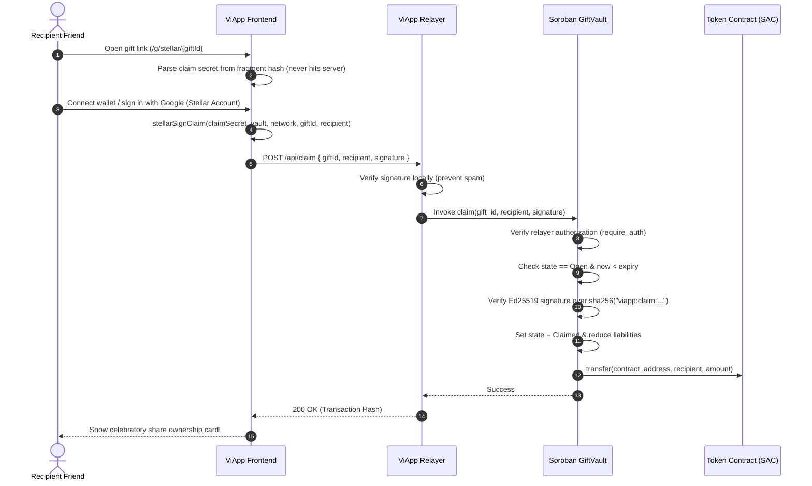

# ViApp Architecture & Protocol Specification

ViApp is a decentralized protocol on Stellar enabling users to purchase, tokenize, and gift shares of real-world stocks (e.g. Apple, NVIDIA, Tesla) as shareable web links. The recipient can claim their gift without owning pre-funded crypto or paying transaction fees, while the sender retains full non-custodial ownership and refund guarantees.

---

## 1. High-Level System Architecture

```mermaid
flowchart TD
    subgraph Client["Client Interface"]
        Sender["Gift Sender\n(XLM / USDC on Stellar)"]
        Recipient["Gift Recipient\n(Web Browser / Google / Passkey)"]
    end

    subgraph AppLayer["Application Layer (@viapp/web)"]
        UI["ViApp Web App\n(Next.js 16 + Tailwind)"]
        Relayer["ViApp Gasless Relayer\n(Submits claim transactions)"]
    end

    subgraph CoreLayer["Core Protocol (@viapp/core)"]
        StellarClient["Soroban SDK Transaction Builders"]
        SEP["SEP Engine\n(SEP-1, SEP-10, SEP-38, SEP-41)"]
        Bridge["Pegging & Settlement Engine\n(1:1 Pegged Stocks)"]
    end

    subgraph OnChain["Stellar Network (Soroban)"]
        Vault["GiftVault Smart Contract\nCDG2MIJEGLAIS37FXNF3KSFIQYL4VN5AUVLRLXK47SHQTHVVILPKCBD4"]
        SAC["Stellar Asset Contracts\n(Native XLM, USDC, Pegged Stocks)"]
        Ledger["Stellar Ledger\n(State Storage + TTL Extensions)"]
    end

    Sender -->|1. Select Stock & Pay XLM/USDC| UI
    UI --> CoreLayer
    CoreLayer -->|2. Create Gift & Lock Tokens| Vault
    Vault -->|3. Escrow Tokens| SAC
    Vault -->|4. Store Gift State with TTL Bump| Ledger

    UI -->|5. Generate Shareable Claim Link| Sender
    Sender -.->|6. Sends Link (SMS / WhatsApp / Email)| Recipient

    Recipient -->|7. Opens Link & Authenticates| UI
    UI -->|8. Signed Claim Payload| Relayer
    Relayer -->|9. Submits claim() on behalf of friend| Vault
    Vault -->|10. Transfers Pegged Stock to Recipient| SAC
```

---

## 2. Deployed Soroban Smart Contract & Live Testnet Evidence

The core smart contract `viapp-gift-vault` is deployed, initialized via atomic `__constructor`, and verified on Stellar Testnet:

* **Contract ID:** [`CDG2MIJEGLAIS37FXNF3KSFIQYL4VN5AUVLRLXK47SHQTHVVILPKCBD4`](https://stellar.expert/explorer/testnet/contract/CDG2MIJEGLAIS37FXNF3KSFIQYL4VN5AUVLRLXK47SHQTHVVILPKCBD4)
* **WASM Hash:** `14e4c5a834f2bd49719a030108c7b9140c6cdeca89859a0f84e58ecc004127b5`
* **Network:** Stellar Testnet (`Test SDF Network ; September 2015`)
* **ViApp Stock Issuer (`viapp-issuer`):** [`GAJZNVL4IOXRII77S22CHDW7E2UWICAMWLFMX22B3YW2PVBQ7RLNNNFN`](https://stellar.expert/explorer/testnet/account/GAJZNVL4IOXRII77S22CHDW7E2UWICAMWLFMX22B3YW2PVBQ7RLNNNFN)
* **ViApp Gasless Relayer (`viapp-relayer`):** [`GANCS3FFF5TPPCBCNO4MFTMEIMDK4BO2LJYTEBG57F3DNX7JRYJ5WTKH`](https://stellar.expert/explorer/testnet/account/GANCS3FFF5TPPCBCNO4MFTMEIMDK4BO2LJYTEBG57F3DNX7JRYJ5WTKH)
* **WASM Upload Transaction:** [`9311be00...`](https://stellar.expert/explorer/testnet/tx/9311be00c2f195ea2b669be8b4da07337da9e0c27a97173165bcb3a50467ff6d)
* **Deploy + Atomic `__constructor` Tx:** [`91a51bd5...`](https://stellar.expert/explorer/testnet/tx/91a51bd598a3f77e3ca50cd0ba5cd96c8b23d53e6174cb444137ab88761e85d2)
* **Dynamic Token Listing (`set_token_listed` QQQ) Tx:** [`a93c5a04...`](https://stellar.expert/explorer/testnet/tx/a93c5a042e1762acd6f1571b001b988071fd87dca76aaa3651eb3869984a859e)
* **Live Testnet Gift #1 (`1.0 NVDA` SAC) Creation Tx:** [`a45ef1cc...`](https://stellar.expert/explorer/testnet/tx/a45ef1cc24c138ccfd2b9e55645247482a4621004816535ec819e45ef902f5cc) *(Created Gift #1, locked 1.0 NVDA SAC, verified Ed25519 claim proof, emitted `GiftCreated` event)*
* **Live Testnet Gift #1 (`1.0 NVDA` SAC) Gasless Claim Tx:** [`abdefd9b...`](https://stellar.expert/explorer/testnet/tx/abdefd9b50f8575178869779022ab3e1171046eefcc460595e1b92dc2c93b109) *(Submitted by `viapp-relayer`, verified Ed25519 signature on-chain, settled 1.0 NVDA SAC to recipient `GDKT5IW7...`, emitted `GiftClaimed` event)*
* **Live Testnet Gift #2 (`0.5 AAPL` SAC, Open) Creation Tx:** [`5b8b7809...`](https://stellar.expert/explorer/testnet/tx/5b8b7809ae715c90e2259c21b46d2c90982ab7a1ddd0437e7a97df4119dfe251)
* **Live Testnet Gift #3 (`0.7 NVDA` SAC, Open) Creation Tx:** [`1b6661dc...`](https://stellar.expert/explorer/testnet/tx/1b6661dcccc7dd4e76de910354c384f18ae19f89f21a5b8f5ebdfa85d0af9bfc)

---

## 3. Core Protocol Workflows

### 3.1 Gift Creation Flow



### 3.2 Gasless Claim Settlement Flow



---

## 4. Tokenized Stocks & Settlement Mechanics

### 4.1 Underlying Stock Liquidity & Custody Venues
To enable gifting of US blue-chip stocks on Stellar without forcing users through traditional brokerage onboarding, ViApp operates a **1:1 backed synthetic stock engine** backed by institutional liquidity venues:

1. **bStocks (BNB Chain / Binance Web3):**
   * Regulated tokenized real-world assets (RWAs) tracking US stocks (AAPL, NVDA, TSLA, MSFT, AMZN, GOOGL, META, SPY, QQQ).
   * Backed 1:1 by physical shares held in bankruptcy-remote Swiss custody (e.g. Backed Finance / CM-Equity AG).

### 4.2 Institutional Reserve Backing: bStocks (BNB Chain)

ViApp automatically routes all stock purchases to 1:1 institutional reserves via bStocks on BNB Smart Chain (Chain 56). This provides deep decentralized liquidity on PancakeSwap V3, verified Swiss custody, and deterministic settlement without multi-venue complexity.

### 4.3 Catalog & Pegged Contract Addresses

| Ticker | Company / Asset | Stellar SAC Address (Soroban) | Backing Venue | Backing Contract Address | Peg Ratio |
| :---: | :--- | :--- | :---: | :--- | :---: |
| **$AAPL** | Apple Inc. | `CBUEWQFAQJUMIU7PU6U64Q35NCGF752BB7JHYKMEUZ6OA7767S66EYJB` | BNB Chain (bStock) | `0x4dd8cb5f44e3f421be0d58852da0e28f32242186` | 1:1 |
| **$NVDA** | NVIDIA Corp | `CAX6GMJ7R4SKDEPHDFPJJMGYXNBWNFUOLDZZIQUV3PMRIMDRGUEY3RZV` | BNB Chain (bStock) | `0x02fca66c1d1afb4e2a7884261eb00f63598a7436` | 1:1 |
| **$TSLA** | Tesla, Inc. | `CCX7WIJYXP2HXPMKKAOLYSMTVTLFYZDRBC5OR3O4S2QGBGUWN5NZQUVU` | BNB Chain (bStock) | `0x12bb94481d81fbe3237e1ba77a83d3170e59a6d8` | 1:1 |
| **$MSFT** | Microsoft Corp | `CA566SBZVF5XPOHA5IBIDNSKJ7OBD5UT7V5LZZUSSQCXJ3BQ7RXNMVAU` | BNB Chain (bStock) | `0x8929e083cbe9a296e8bc371c6fa611fe28114fcf` | 1:1 |
| **$AMZN** | Amazon.com Inc. | `CCSCABC5NOE7VSZY7FJOOQOGVIHIHCXW2G5ETERS3J2CPAMF3DKFLAOL` | BNB Chain (bStock) | `0xa8417c8cf15239a5ec13e9a7e6b010f3c5b557fb` | 1:1 |
| **$GOOGL** | Alphabet Inc. | `CDLGAWB22W2PSU6UBTIC2O2XOX7AXQQXEM6V4TGIZWW6OH6VA6NAHXJD` | BNB Chain (bStock) | `0x539591e6005cbbce4ebcc47cfdc3500d8ce20c6a` | 1:1 |
| **$META** | Meta Platforms | `CABP7JTR5F7VAX73NIWFAMJVN3HDAOG6TALS62UEUQHY3ZSJ3T23VKWC` | BNB Chain (bStock) | `0x7425889FE94F9d693E8daefE88BCCed6AcFEf4c0` | 1:1 |
| **$SPY** | S&P 500 ETF | `CCD3SEF2BGN4FSSQLXACT2V2I7QWVA2HW54HJCWJMKHKJ7ZYSXXCSH5Z` | BNB Chain (bStock) | `0x98f260340b3cb1c95116df14e8ee1c183bbd3257` | 1:1 |
| **$QQQ** | Invesco QQQ Trust | `CCON7JI5MMA2A55E4K6VCAVQV4GXP37BLPBRIKENFPSSP33ADTF7C7Q7` | BNB Chain (bStock) | `0x205812CdBed920aFf76C6580abD681a46D11efc7` | 1:1 |

### 4.4 Roadmap Architecture: Native Stellar Tokenization & Direct On-Chain Liquidation (Beyond Pegged Assets)

While ViApp's Testnet proof-of-concept operates with 1:1 pegged synthetic stocks backed by custodial reserves (bStocks), our target architecture **eliminates cross-chain bridges and pegged assets entirely by bringing natively liquidated and tokenized stocks directly into the Stellar blockchain**.

```mermaid
flowchart LR
    subgraph Issuance["1. Direct Native Issuance"]
        Broker["Regulated Broker-Dealer /\nTransfer Agent (SEC/FINMA)"] -->|SEP-8 Regulated Mint| NativeStock["Native Stellar Stock\n(AAPL / NVDA / TSLA SAC)"]
    end

    subgraph Escrow["2. Gift Escrow & Claim"]
        NativeStock -->|Locked in Escrow| Vault["Soroban GiftVault\nCDG2MIJE..."]
        Vault -->|Gasless Relayer Claim| Recipient["Gift Recipient Wallet"]
    end

    subgraph Liquidation["3. Direct On-Chain Liquidation"]
        Recipient -->|1-Click Sell Order| SDEX["Stellar SDEX Orderbooks /\nSoroban AMM Liquidity Pools"]
        SDEX -->|Sub-second Settlement| USDC["Native Stellar USDC / XLM"]
        USDC -.->|Optional Off-Ramp| Cash["Local Fiat Cash\n(SEP-24 / MoneyGram Access)"]
    end
```



#### 1. Direct Native Issuance via SEP-0008 & SEP-0041
- **Regulated Asset Architecture:** Stocks are issued directly on Stellar utilizing **SEP-0008 (Regulated Assets)**. The issuer maintains flags `AUTH_REQUIRED` and `AUTH_REVOCABLE`, ensuring compliance with global securities laws, automated sanctions screening, and investor whitelisting.
- **Soroban SAC Compatibility:** Each native stock is mapped directly to a Soroban Stellar Asset Contract (SAC) adhering to **SEP-0041**, allowing seamless integration into the `viapp-gift-vault` without custom wrapper contracts.
- **Bankruptcy-Remote Custody:** Institutional broker-dealer partners hold underlying shares in qualified custody accounts directly mapped to Stellar asset supply, audited via automated Proof of Reserves (PoR).

#### 2. Direct On-Chain Liquidation (Instant Cash-Out)
- **Eliminating External Bridge Hops:** When a recipient wants to liquidate their stock, the trade executes directly on Stellar via:
  1. **Stellar Decentralized Exchange (SDEX):** Native on-chain limit orderbooks with centralized exchange-grade matching speed.
  2. **Soroban AMM Liquidity Pools:** Automated constant-product pools (`STOCK/USDC`) ensuring guaranteed execution even during after-market hours.
- **Sub-Second Finality & Micro-Fees:** Trades settle on Stellar in 3 to 5 seconds with transaction fees below `$0.0001`, in contrast to high gas fees and multi-minute bridge latency on EVM networks.
- **Direct Cash Settlement:** Liquidation directly deposits native Stellar USDC or XLM into the user's wallet, ready for immediate spending or withdrawal via MoneyGram Access in 180+ countries.

#### 3. Native Corporate Actions & Dividend Streaming
- **Automated Dividend Streaming:** When a public company distributes quarterly cash dividends, the issuing anchor computes on-chain snapshot balances and automatically streams proportional Stellar USDC payments directly into token holders' Stellar accounts.
- **Zero Bridge Vulnerabilities:** Because shares exist natively on Stellar, the entire system is immune to cross-chain bridge hacks, multi-sig relayer compromises, and synthetic de-pegging events.

---

## 5. Soroban Storage & TTL Lifecycle

Soroban storage fees are tiered into `Instance` and `Persistent` storage. ViApp manages these deterministically to prevent state eviction:

| Storage Type | Key | Purpose | TTL Bump Policy |
|:---|:---|:---|:---|
| **Instance** | `Admin`, `Relayer`, `NextGiftId`, `IsPaused` | Global protocol parameters | Bumped by `7 days` whenever TTL drops below `1 day`. |
| **Persistent** | `Gift(gift_id)` | Individual gift record (token, sender, amount, expiry, state) | Bumped by `95 days` (exceeding maximum 90-day gift lifetime). |
| **Persistent** | `ClaimKeyUsed(claim_key)` | Nullifier preventing replay of claim keys | Persists indefinitely to guarantee one-time use. |
| **Persistent** | `Liabilities(token)` | Real-time accounting of tokens currently escrowed | Updated on every `create_gift`, `claim`, and `refund`. |

---

## 6. Stellar Standards Compliance (SEPs)

ViApp integrates standard Stellar Ecosystem Proposals to guarantee interoperability:

* **SEP-0001 (Stellar Info File):** Machine-readable discovery (`stellar.toml`) exporting protocol metadata, signers, currencies, and anchor endpoints. Implemented in [`packages/core/src/sep1.ts`](file:///C:/Users/User/.gemini/antigravity/scratch/viapp/packages/core/src/sep1.ts).
* **SEP-0010 (Stellar Web Authentication):** Standardized challenge transaction builder and validator for mutual authentication between client and relayer. Implemented in [`packages/core/src/sep10.ts`](file:///C:/Users/User/.gemini/antigravity/scratch/viapp/packages/core/src/sep10.ts).
* **SEP-0024 (Hosted Deposit and Withdrawal):** Interactive web flows for fiat on-ramping and off-ramping directly into gifts. Implemented in [`packages/core/src/sep24.ts`](file:///C:/Users/User/.gemini/antigravity/scratch/viapp/packages/core/src/sep24.ts).
* **SEP-0038 (Anchor RFQ Quotes API):** Standardized indicative pricing and firm quote requests for converting between on-chain assets (USDC, XLM) and tokenized stocks. Implemented in [`packages/core/src/sep38.ts`](file:///C:/Users/User/.gemini/antigravity/scratch/viapp/packages/core/src/sep38.ts).
* **SEP-0041 (Stellar Asset Contract):** Direct token escrow using standardized SAC interfaces (`transfer`, `balanceOf`).

---

## 7. Threat Model & Security Invariants

1. **Checks-Effects-Interactions:** State transitions (`gift.state = Claimed` or `Refunded`) are committed before any token transfer is executed, preventing reentrancy.
2. **Replay Protection via Cryptographic Digest:** Every registration and claim signature includes the `network_id`, `contract_id`, `gift_id`, and `recipient` in the signed preimage. A signature captured on Testnet cannot be replayed on Mainnet or across distinct contracts.
3. **Sender Refund Guarantee:** The sender can invoke `refund(gift_id)` at any time after `expiry` has elapsed. The `refund()` function is strictly unpausable, guaranteeing that administrative actions can never trap user funds.
4. **Zero-Knowledge Gift Link:** The secret claim key is transmitted entirely within the URL fragment hash (`#...`), ensuring it is never transmitted over HTTP headers or stored in web server access logs.

