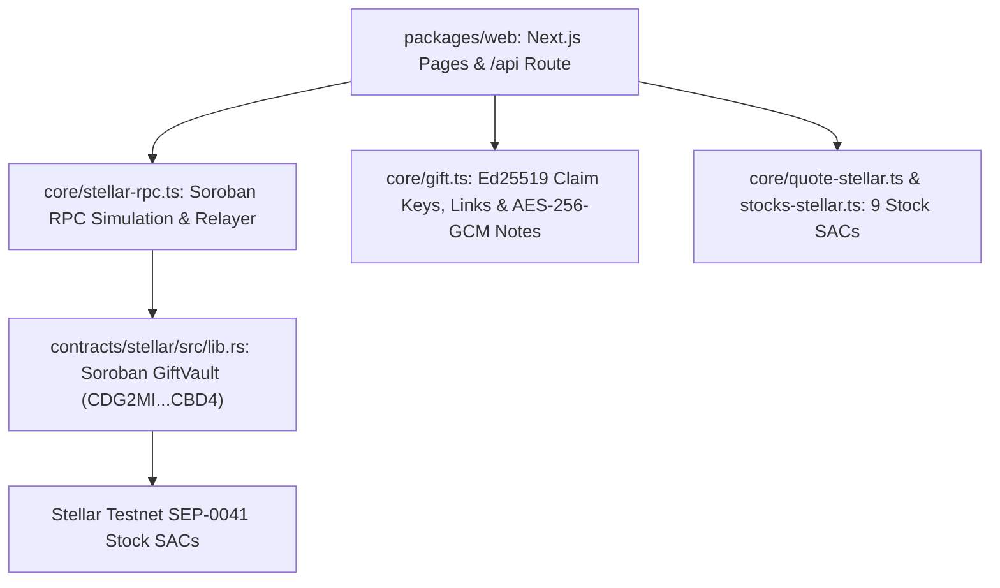

ViApp's Next.js API route (`/api/*`) connects the web interface to the deployed **Soroban `GiftVault` smart contract (`CDG2MIJEGLAIS37FXNF3KSFIQYL4VN5AUVLRLXK47SHQTHVVILPKCBD4`)** on Stellar Soroban RPC (`https://soroban-testnet.stellar.org`).

Every endpoint answers JSON with `Content-Type: application/json; charset=utf-8`, `X-Content-Type-Options: nosniff`, and `Cache-Control: no-store`.

## Endpoints Overview

| Endpoint | Method | Purpose |
|---|---|---|
| `GET /api/stocks` | `GET` | Returns the 9 listed tokenized stock Stellar Asset Contracts (SACs) with SAC contract IDs, issuer (`GAJZNVL4...NNFN`), 7-decimal precision, and reference USD prices. |
| `GET /api/stats` | `GET` | Reads live on-chain gift statistics (`nextGiftId`, `made`, `opened`, `waiting`, `latest`) directly from the Soroban `GiftVault` contract via Stellar RPC. |
| `GET /api/gift/{id}` | `GET` | Simulates `get_gift(id)` on the Soroban `GiftVault` contract and returns the on-chain `Gift` record (`state`, `token` SAC ID, `symbol`, `shares`, `expiry`, `claimKey` `G...`, `sealedNote`). |
| `POST /api/quote` | `POST` | Computes expected and 1%-slippage-bounded 7-decimal share outputs for a Stellar stock gift (`{ stock, usdAmount, wallet }`). |
| `POST /api/claim` | `POST` | Verifies the recipient's Ed25519 signature over `viapp:claim:{network}:{vault}:{giftId}:{recipient}` and submits the sponsored `claim()` transaction via ViApp's Stellar Relayer (`GANCS3FF...WTKH`). |

---

### `GET /api/stocks`

Returns the 9 giftable tokenized stocks deployed as Stellar Asset Contracts (SACs) on Stellar Testnet:

```json
{
  "chain": "stellar",
  "stocks": [
    {
      "chain": "stellar",
      "code": "NVDA",
      "symbol": "NVDA",
      "name": "NVIDIA Corp",
      "issuer": "GAJZNVL4IOXRII77S22CHDW7E2UWICAMWLFMX22B3YW2PVBQ7RLNNNFN",
      "contractId": "CAX6GMJ7R4SKDEPHDFPJJMGYXNBWNFUOLDZZIQUV3PMRIMDRGUEY3RZV",
      "address": "CAX6GMJ7R4SKDEPHDFPJJMGYXNBWNFUOLDZZIQUV3PMRIMDRGUEY3RZV",
      "decimals": 7,
      "uiMultiplier": "10000000",
      "priceUsd": "142.20",
      "market": { "open": true, "reasonCode": null, "reasonMsg": null, "nextOpenTime": null }
    }
  ],
  "asOf": 1795701418000
}
```

---

### `GET /api/gift/{id}`

Reads a gift directly from the Soroban `GiftVault` contract (`CDG2MIJEGLAIS37FXNF3KSFIQYL4VN5AUVLRLXK47SHQTHVVILPKCBD4`):

```json
{
  "ok": true,
  "giftId": "2",
  "state": "Open",
  "token": "CBUEWQFAQJUMIU7PU6U64Q35NCGF752BB7JHYKMEUZ6OA7767S66EYJB",
  "symbol": "AAPL",
  "name": "Apple Inc.",
  "decimals": 7,
  "amountRaw": "5000000",
  "shares": "0.5",
  "expiry": "1798294435",
  "claimKey": "GCOWXLJOXV3PF26RQOKRWDX23Y56VC3KC3ZXLBVRESNF56Z3DJDE6X5X",
  "sealedNote": "0x01...",
  "senderCompliant": true
}
```

---

### `POST /api/quote`

Request:
```json
{
  "stock": "NVDA",
  "usdAmount": "25.00",
  "wallet": "GAZWESWQPZOIH2EH3IL37THBLKGLAC5FCHTLMWAXJGLKJPT4NRRIHN6B",
  "chain": "stellar"
}
```

Response `200`:
```json
{
  "ok": true,
  "chain": "stellar",
  "usdAmount": "25.00",
  "expectedShares": "0.1758087",
  "minShares": "0.1740506",
  "priceUsd": "142.20",
  "trustlineRequired": true
}
```

---

### `POST /api/claim`

Verifies the 64-byte Ed25519 claim signature created by the `#claimSecret` in the browser and submits `GiftVault.claim(gift_id, recipient, signature)` via the Stellar relayer:

Request:
```json
{
  "giftId": "2",
  "recipient": "GBD556B4ETLN5IZ4DUHAITMDQNNPLSCGJHSICVV4OL5TPEF4XZILB6SL",
  "signature": "0x...",
  "declaration": true,
  "chain": "stellar"
}
```

Response `200`:
```json
{
  "ok": true,
  "txHash": "0xabdefd9b50f8575178869779022ab3e1171046eefcc460595e1b92dc2c93b109",
  "reused": false
}
```

---

## Architecture Flow


